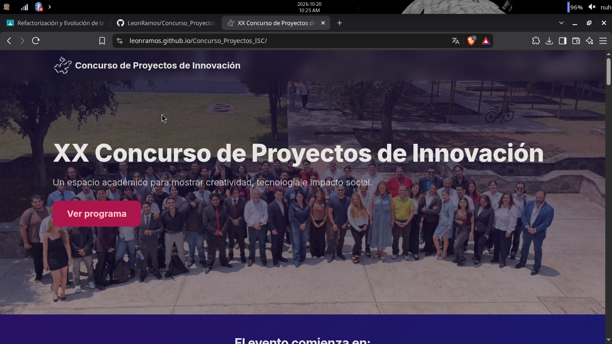
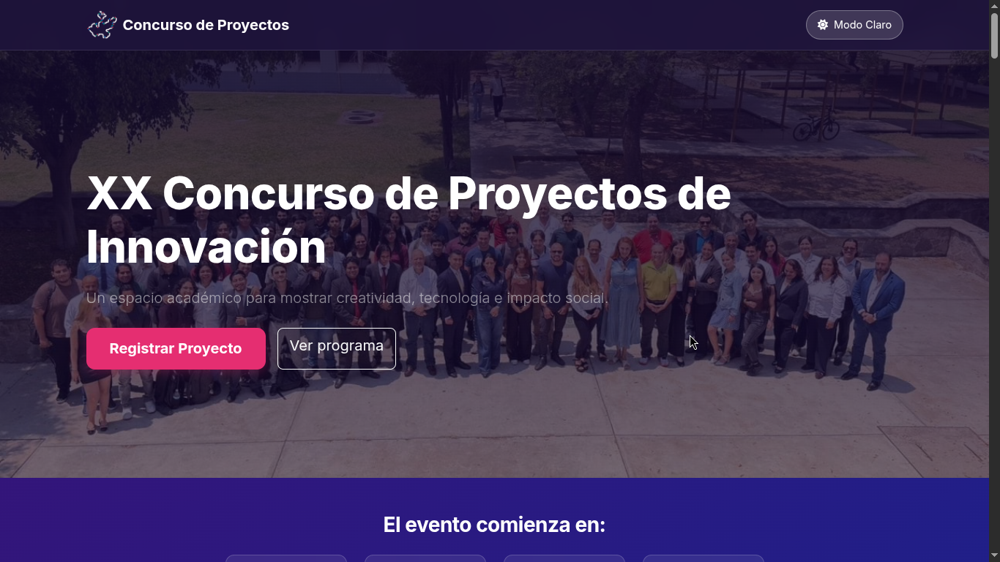
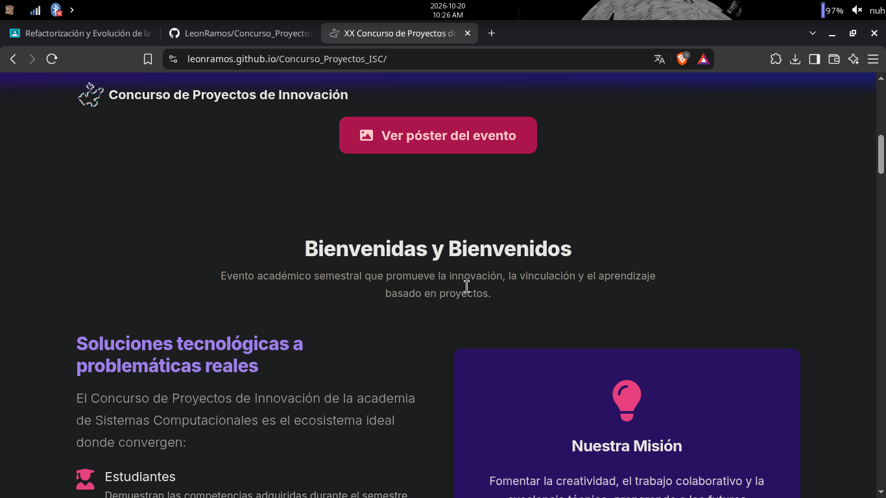
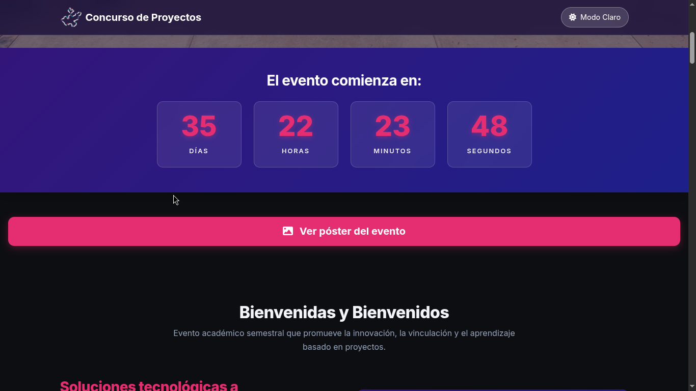
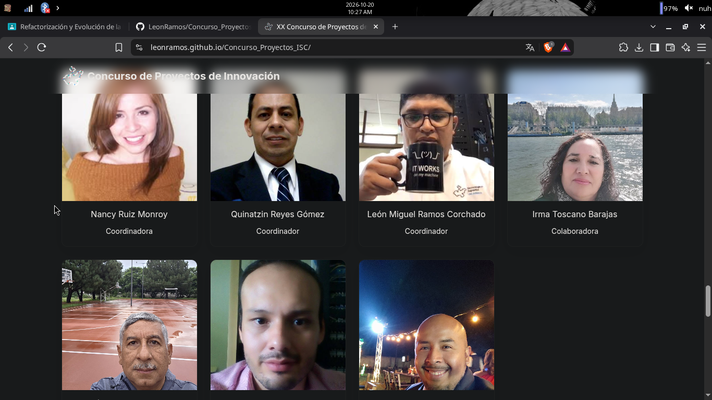
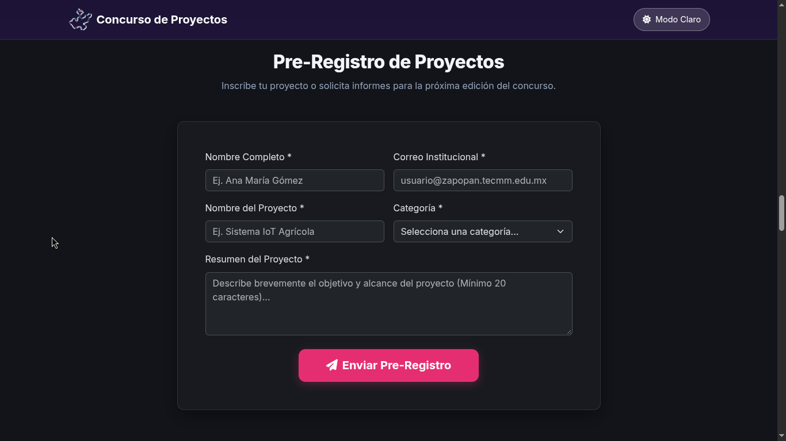

# 🚀 XX Concurso de Proyectos de Innovación — TecMM Zapopan

Repositorio oficial del sitio web del **XX Concurso de Proyectos de Innovación**, organizado por la Academia de Ingeniería en Sistemas Computacionales del Instituto Tecnológico José Mario Molina Pasquel y Henríquez (Unidad Académica Zapopan).

---

## 🌐 Sitio Web en Producción

Puedes consultar la versión publicada y en línea del proyecto en el siguiente enlace:

👉 **[Ver Sitio Publicado en GitHub Pages / Hosting](#)** *(Reemplazar con la URL real de tu proyecto)*

---

## ✨ Mejoras Realizadas

Se llevó a cabo una refactorización integral del sitio web abarcando arquitectura, diseño, interactividad y rendimiento:

### 1. Estructura y Semántica Web (HTML5 & A11y)
* **Semántica de etiquetas:** Sustitución de contenedores genéricos (`
`) por elementos semánticos de HTML5 (`<header>`, `<nav>`, `<main>`, `<section>`, `<article>`, `<aside>`, `<footer>`).
* **SEO & Social Share:** Implementación de metadatos de SEO básico (`description`, `keywords`, `robots`) y etiquetas **Open Graph** y **Twitter Cards** para previsualizaciones enriquecidas al compartir en redes sociales y mensajería (WhatsApp, LinkedIn, Facebook).
* **Accesibilidad (A11y):** Inclusión de atributos `alt` descriptivos en todas las imágenes, jerarquía lógica de encabezados (`h1`-`h6`), atributos `aria-labelledby` y `aria-hidden` para lectura por tecnologías asistivas.

### 2. Diseño, Maquetación y Experiencia de Usuario (CSS3)
* **Enfoque Mobile-First:** Maquetación adaptativa fluida diseñada para funcionar desde pantallas móviles de 320px en adelante mediante **Flexbox** y **CSS Grid**.
* **Variables CSS & Identidad Institucional:** Paleta de colores oficial del TecMM gestionada mediante variables (`--primary`, `--accent`, `--secondary`).
* **Selector de Modo Claro / Modo Oscuro:** Interruptor interactivo en la barra de navegación con persistencia de preferencia utilizando `localStorage`.
* **Microinteracciones:** Efectos al pasar el cursor (`:hover`), elevar tarjetas (`transform: translateY`), feedback táctil en botones y estados de foco visibles (`:focus-visible`).

### 3. Dinamismo e Interactividad (JavaScript ES6+)
* **Contador Regresivo en Tiempo Real:** Temporizador dinámico que calcula días, horas, minutos y segundos faltantes para el evento.
* **Catálogo Filtrable de Proyectos:** Sección interactiva que permite filtrar proyectos ganadores anteriores por área temática (*Desarrollo Web, IA, IoT, App Móvil*) mediante manipulación dinámica del DOM.
* **Validación de Formulario en Tiempo Real:** Validación interactiva para el pre-registro de proyectos (verificación de campos obligatorios y formato de correo institucional `@tecmm.edu.mx` o `@zapopan.tecmm.edu.mx`) con respuesta asíncrona sin recargar la página.
* **Sección FAQ:** Acordeón interactivo para consultar preguntas frecuentes del concurso.

### 4. Optimización de Rendimiento
* **Formatos Modernos:** Conversión e integración de todas las imágenes a formato **WebP** para reducir drásticamente el peso de carga.
* **Carga Perezosa (*Lazy Loading*):** Implementación del atributo `loading="lazy"` en imágenes e `iframe` fuera de la vista inicial (*below the fold*) para optimizar la métrica *Largest Contentful Paint* (LCP).

---

## 🛠️ Tecnologías y Librerías Utilizadas

* **Lenguajes:** HTML5, CSS3, JavaScript (ES6+).
* **Framework CSS:** [Bootstrap 5.3](https://getbootstrap.com/) (Sistema de Grid, Componentes Modales, Acordeón, Clases de Utilidad).
* **Tipografías e Íconos:**
  * [Font Awesome 6.5](https://fontawesome.com/) (Íconos vectoriales).
  * [Google Fonts - Inter](https://fonts.google.com/specimen/Inter) (Tipografía principal).
* **Optimización de Medios:** Formato WebP y API nativa de *Lazy Loading*.

---

## 📸 Capturas de Pantalla (Antes y Después)

| Versión Original (Antes) | Versión Refactorizada (Después) |
| :---: | :---: |
|  |  |
|  |  |
|  |  |
| *Estructura basada en divs genéricos sin metadatos ni modo oscuro.* | *Diseño semántico con variables CSS, responsive y componentes interactivos.* |

---

## ✒️ Autor / Créditos

Desarrollado y refactorizado por **[Tu Nombre Completo / Nombre de usuario de GitHub]** para la Academia de Ingeniería en Sistemas Computacionales de la **Unidad Académica Zapopan (TecMM)**.